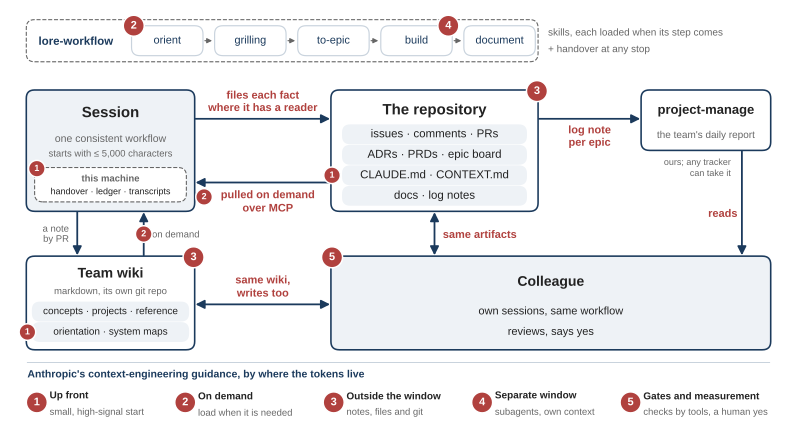

# Lore

**A workflow and knowledge layer for teams that code with Claude Code.**
Each session starts with a small, repo-scoped context. It follows one
workflow from idea to merged PR. It files every fact where someone will
read it: issues, PRs, ADRs and PRDs, a git-backed team wiki, a logbook.
Lore itself calls no model. The agent in the session does the judging.

> ⚠️ **Pre-1.0.** APIs, hook contracts, skill surfaces, frontmatter
> schema, and CLI flags can still change between minor versions.

## How it works



The figure is from the ADASS 2026 talk; the bullets below describe Lore today.

- **Session.** At SessionStart, Lore injects a small context: a status
  line with the last active day, the repo's orientation note, system-map
  neighbours, the index, a pointer to the handover note if one is waiting,
  and pending freshness verdicts. The index names where an agent can ask
  (the route of the repo and your scopes) and what the repo holds. Each
  block keeps its own budget. Everything deeper is
  **pulled on demand over MCP** (`lore_search`, `lore_read`,
  `lore_context_pack`, …).
- **This machine.** Hooks register every transcript in a ledger, stamped
  with repo, branch, PRs, issues, commits and files from git. No model
  call is involved. Session transcripts are mirrored to the wiki's
  gitignored `.transcripts/` directory; handover notes and token records
  also stay local.
- **The repository.** The session files each fact as the artifact that
  already has a reader: an issue, a comment, a PR, an ADR or PRD,
  `CLAUDE.md` / `CONTEXT.md`, docs. See
  [file facts as artifacts](docs/how-to/file-facts-as-artifacts.md).
- **Team wiki.** A markdown wiki in its own git repo: projects, concepts,
  the orientation note per repo, and system maps across repos. Notes
  arrive by PR or `/lore:inbox`; Lore mirrors private transcripts there
  but does not compose wiki notes.
- **Logbook.** Every finish point writes a logbook entry to a configured
  sink: a file in the repo, or a command such as a project tracker. See
  [use the logbook](docs/how-to/use-the-logbook.md).
- **Colleagues** work on the same artifacts and the same wiki, with the
  same workflow.

## One plugin: `lore`

This repo is a Claude Code marketplace with one plugin, `lore`: hooks, the
MCP server, and every skill as `/lore:<name>`. The planning-and-build chain:

```
orient → grilling → to-epic → build → document     (+ handover at any stop)
```

`build` runs in three modes: `loop` for fast rounds with you watching,
`issue` for one clear issue, `epic` for a build order of sub-issues. `tdd`
is the discipline every mode follows; `debug`, `experiment`, `triage` and
`file-issue` are helpers. The build skills call the `lore` CLI and MCP
surface (`lore codemap`, `lore tier resolve`, `lore workflow
validate-build-order` / `create-prd`). Onboard a repo with
`lore setup scope --scaffold-workflow`. The spawn rules the skills share live
in [`skills/TIER-DELEGATION.md`](skills/TIER-DELEGATION.md).

The build skills:

| Skill | What it does |
|---|---|
| `/lore:orient` | First step of a task: homework, then reflect understanding back. A light mode ("brief me") pulls only the roadmap and the context pack, and hands one change to `build`. |
| `/lore:grilling` | Interview the user to stress-test a plan, and sharpen the domain model: `CONTEXT.md` terms and ADRs with `Holds` and `Revisit if`. |
| `/lore:to-epic` | Turn a plan into a PRD file plus an epic tracker issue with a build-order table. |
| `/lore:build` | Build code in three modes: `loop` (fast rounds, local merges, one wrap-up PR), `issue` (one issue, one PR), `epic` (a build order, teammates, review by risk level). Keeps a ledger and writes a handover section. |
| `/lore:tdd` | Test-driven red-green-refactor loop. |
| `/lore:debug` | Systematic root-cause debugging with a hard circuit breaker. |
| `/lore:experiment` | Run one experiment: write the question and the expected result, run it, write one lab entry with `lore lab add` and commit it. |
| `/lore:document` | Bring the Diátaxis docs in line with the code: pre-merge, catch-up, or a plan-approved consolidation of a docs tree. Marks a shipped PRD at the epic tail. |
| `/lore:file-issue` | Writes issue text and files it: resolve the writing rules, draft, Vale-lint, then post the issue or PR body. |
| `/lore:triage` | Reviews every open issue and PR of a repo against the code, gives each a verdict, and presents one filterable page for discussion. Review only until the user decides. |

The context and upkeep skills:

| Skill | What it does |
|---|---|
| `/lore:context` | Show what Lore injected this session. |
| `/lore:handover` | Part one writes a handover note for the next session. Part two writes the handover section for work that stops early, and turns follow-up work into a seed issue. |
| `/lore:inbox` | Route inbox files into the right wiki. |
| `/lore:map` | Keep the system map true across repos. |
| `/lore:system` | Bring every checkout of a system to its target branch. |
| `/lore:verify` | Resolve pending freshness verdicts. |
| `/lore:curator` | Frontmatter hygiene: supersession, back-links, dates. |

## Install

Linux and macOS:

```bash
curl -fsSL https://raw.githubusercontent.com/buchbend/lore/main/install.sh | sh
```

The script installs the `lore` CLI with `pipx`, `uv tool` or `pip --user`,
then runs `lore setup`. Setup creates or links a wiki and installs the
Claude Code plugin, plus Cursor's MCP wiring where present. It offers a
scope for the current repo and runs the checks. Upgrade later with `lore update`.

By hand:

```bash
pipx install "git+https://github.com/buchbend/lore.git#egg=lore"
lore setup
```

> The bare `pipx install lore` will *not* work: the name is taken on PyPI
> by an unrelated package.

The plugin only, from inside Claude Code (you still need the CLI):

```text
/plugin marketplace add buchbend/lore
/plugin install lore@lore
```

`lore setup` is also the repair command. On a healthy setup it writes
nothing; `lore setup --yes` runs without a terminal. `lore uninstall`
removes everything Lore added. For an editable or offline install, see
[CONTRIBUTING.md](./CONTRIBUTING.md).

## Configure

**Vault layout.** `$LORE_ROOT` (default `~/lore`) holds `wiki/` with one or
more mounted wikis, an optional `inbox/`, and a `CLAUDE.md`. Each wiki is
its own git repo, mounted as a symlink or an inline directory:

```bash
ln -s ~/git/myorg/team-knowledge ~/lore/wiki/team   # mount an existing wiki
lore wiki new research                              # or scaffold a new one
```

**Scopes.** A scope maps a folder of repos to a wiki, in
`~/.config/lore/config.yml`. Every repo below that folder uses the wiki.
A committed `.lore.yml` in a repo holds exceptions only.

```bash
lore setup scope ~/git/myorg     # or: --name myorg --wiki team --remote 'github.com/myorg/*'
```

**Sources and sinks.** `lore setup source` adds search sources beyond the
wiki and GitHub (DokuWiki, any command). `lore setup sink` sets where
logbook entries go. `lore config` shows the resolved configuration and
where each value comes from; `lore config secret` stores tokens.

Guides: [onboarding](docs/how-to/onboarding.md),
[route repos to a wiki](docs/how-to/route-repos-to-a-wiki.md),
[onboard a repo](docs/how-to/onboard-a-repo.md),
[keep a system map](docs/how-to/keep-a-system-map.md).

## Daily use

| Command | What it does |
|---|---|
| `lore status` | Health: capture, wikis, retention, alerts. Run it first when something seems off. |
| `lore stats` | Token-use and systems pages in the browser. |
| `lore search` / `lore read` | Search the wiki index; composite retrieval. The same as the MCP tools. |
| `lore log add\|flush\|show` | Write, retry or show logbook entries. |
| `lore lab add\|show` | Record or review lab-notebook entries. |
| `lore index` | Print the index: the route, your scopes, glossary terms, ADRs, PRDs, roadmap, neighbours and recent lab entries. |
| `lore roadmap add` | Add an idea to the roadmap. |
| `lore system status\|target` | Git state of every repo in a system; its target branch. |
| `lore trace tokens <session>` | Token totals per skill or subagent phase. |
| `lore update` | Upgrade the CLI and plugins. |

Event logs live in `$LORE_ROOT/.lore/spine.jsonl`. See
[observability](docs/architecture/observability.md) and
[troubleshooting](docs/how-to/troubleshooting.md).

## Design principles

- **Markdown and git stay authoritative.** No database the vault cannot be
  rebuilt from.
- **One home per fact.** Each fact lives in the artifact that already has a
  reader; nothing is extracted from transcripts behind your back.
- **Small context up front, the rest on demand.** Bounded, deterministic
  context at SessionStart; the agent pulls more over MCP when it needs it.
  No auto-enrichment on every tool call.
- **No model call in Lore.** Hooks, capture and curation are deterministic.
  The agent in the session does the judging.

## Documentation

- [`docs/how-to/`](docs/how-to/): task recipes (run an epic, use the fast
  path, hand over a session, run an experiment, keep a roadmap, record a
  decision, …).
- [`docs/explanation/`](docs/explanation/): why the design is as it is.
- [`docs/architecture/`](docs/architecture/): internals (CLI contract,
  config, ledger, state, sync, observability).
- [`docs/conventions.md`](docs/conventions.md): the full chain, where each
  fact lives, the model-tier vocabulary.

## Credits

The grilling method, the shared-language glossary (`CONTEXT.md`), the ADR format and the
TDD skill come from Matt Pocock's
[`mattpocock/skills`](https://github.com/mattpocock/skills) (MIT). The step from a
conversation to a PRD and issues is his idea too. The rest of `lore`
is our own. [skills/THIRD-PARTY.md](./skills/THIRD-PARTY.md) says exactly
which parts are his, what we changed, and holds his licence.

## License

MIT. See [LICENSE](./LICENSE).
